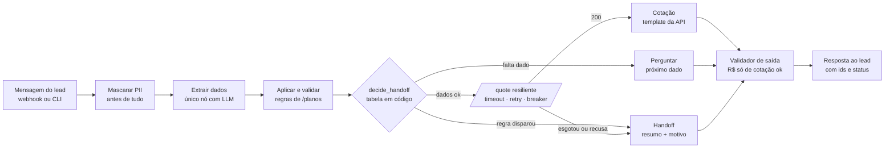

# Agente AutoSeguro — desafio FDE Namastex

Agente de WhatsApp que conversa com o lead, qualifica, cota seguro auto pelo `POST /quote`
e decide entre resolver sozinho ou passar para um humano. **O LLM conversa e extrai dados;
o código decide fluxo, preço e handoff.** Quando a API de cotação falha, o agente tenta de
novo com critério, avisa o lead com honestidade e passa para um consultor, sem nunca
inventar preço.

> O enunciado original do desafio está em [`docs/CHALLENGE.md`](docs/CHALLENGE.md).

## Como rodar

Com Docker (só isso é necessário):

```bash
docker compose up --build -d   # quote-service, Redis, API do agente e worker
make demo                      # conversa completa com timeout, 5xx e retry visíveis
```

**Dashboard: http://localhost:8080/dashboard**: conversas, custos de token, latência por nó,
cache, fila, consultas quentes, trace de cada turno, chat manual e um botão que roda o
golden set (ver [Cache, filas e dashboard](#cache-filas-e-dashboard)).

Sem `make`: os comandos de cada alvo estão no [`Makefile`](Makefile). Para conversar no terminal:

```bash
docker compose exec agent python -m autoseguro_agent.cli --fake-llm --events
```

Por padrão o agente sobe com o `FakeLLM` (extrator determinístico, sem chave). Para usar o
Claude, coloque `ANTHROPIC_API_KEY=...` em `agent/.env` (não versionado): o dashboard passa a
oferecer **FakeLLM ou Claude em cada conversa** e no golden set. `AGENT_LLM_PROVIDER=anthropic`
só muda o padrão (webhook e conversas sem escolha).

Para desenvolver (precisa de [uv](https://docs.astral.sh/uv/)):

```bash
make setup     # dependências travadas pelo uv.lock
make test      # unitários + contrato contra a API real + cenários
make golden    # 20 cenários roteirizados contra a API sem falha simulada
make chaos     # 50 conversas contra a API com 60% de falha e 20% de lentidão
make check     # ruff + mypy --strict + testes (o que roda antes de cada commit)
```

Webhook no formato do WhatsApp Cloud API:

```bash
curl -X POST localhost:8080/webhook/whatsapp -H 'content-type: application/json' -d '{
  "entry":[{"changes":[{"value":{"messages":[{"from":"5511900000001","id":"wamid.1",
  "type":"text","text":{"body":"tenho 35 anos, Onix 2022, cep 01310-100, completo"}}]}}]}]}'
curl localhost:8080/conversations/<conversation_id>   # linha do tempo com ids e status
```

## Fluxo



Um grafo LangGraph com **um único nó de LLM** (extração com saída estruturada). Regras de
handoff, elegibilidade, chamada ao `/quote` e validação de saída são código determinístico
e testado. Arquitetura hexagonal pequena: o domínio não conhece LangGraph, httpx, SQLite
nem o SDK do LLM (um teste quebra se conhecer). Detalhes em
[`docs/ARCHITECTURE_AND_PRACTICES.md`](docs/ARCHITECTURE_AND_PRACTICES.md).

## Decisões

Cada decisão tem contexto, alternativa e trade-off em [`docs/DECISIONS.md`](docs/DECISIONS.md).
O processo seguiu SDD: [requisitos](docs/sdd/01-requirements.md) →
[design](docs/sdd/02-design.md) → [tarefas](docs/sdd/03-tasks.md) → teste → código.

### Quando o `/quote` falha (o diferencial)

Medi antes de decidir: 200 chamadas na configuração padrão deram **20,5% de 5xx, 8% de
respostas lentas (8 s) e 71,5% de sucesso rápido na 1ª tentativa**
([evidência](docs/evidence/quote_characterization.md)).

1. **Validar antes de chamar.** A API sorteia a falha antes da regra de negócio: um 503 não
   diz se o payload seria recusado. Idade, idade do veículo, plano, CEP e data são checados
   com as regras de `GET /planos` (snapshot versionado como fallback). Pelo dataset, ~30%
   dos leads seriam recusados: nesses casos o agente nem chama a API.
2. **Timeout de 3 s por tentativa.** A lentidão é `sleep(8)` e **depois** sucesso: sem timeout
   o lead esperaria 8 s. O teto vale para a tentativa inteira (`asyncio.timeout`), não só por
   operação de rede.
3. **Retry só em 5xx e timeout**, até 3 tentativas, backoff exponencial com jitter
   (~0,5 s, ~1 s), orçamento total de 12 s. Nunca em 400/422: repetir não muda a resposta.
4. **Circuit breaker por pedido**: 5 pedidos falhos seguidos abrem o circuito por 30 s, e o
   agente responde e passa para humano sem martelar o legado.
5. **Mensagem de espera** se passar de 4 s: no WhatsApp, silêncio parece abandono.
6. **Esgotou**: "o sistema de cotação está instável e não quero te passar um valor errado;
   um consultor vai te enviar a cotação", e handoff com os dados já coletados.
7. **Preço nunca inventado**: o LLM não tem campo para escrever valores; mensagens com número
   saem de templates preenchidos pela resposta 200, e um validador bloqueia qualquer R$ que
   não esteja na última cotação `success` (ou nas franquias do `/planos`).
8. **Idempotência explícita**: `quote_request_id` por pedido e `quote_attempt_id` por
   tentativa, enviados em headers (o `/quote` é cálculo puro, mas a intenção fica visível).

### Critério de handoff

Função pura `decide_handoff(contexto)` em [`domain/handoff.py`](agent/src/autoseguro_agent/domain/handoff.py):
uma regra por linha, avaliada em ordem de prioridade, um teste por regra e um teste que
quebra se surgir regra sem teste. O LLM só sinaliza intenções; quem decide é o código.

| Regra | Gatilho | Por quê | Prioridade |
|---|---|---|---|
| `explicit_request` | Pede atendente ou humano | Respeitar o cliente; insistir custa a venda | imediata |
| `infra_unavailable` | Retries esgotados ou breaker aberto | Não inventar preço nem deixar o lead sem resposta | imediata |
| `risk_or_conflict` | Reclamação, Procon, irritação forte | Situação sensível pede pessoa | alta |
| `out_of_policy` | Condutor > 75 ou < 18, carro > 20 anos, recusa da API | Exceção comercial é decisão humana | alta |
| `out_of_scope` | Sinistro, cancelamento, endosso, 2ª via, frota, Uber/app | O agente só vende seguro individual novo | alta |
| `agent_bug` | 422 de schema do FastAPI | Erro nosso: humano assume e o log vira bug | alta |
| `price_negotiation` | Desconto, cobrir concorrente, parcelamento especial | Sem alçada de desconto | média |
| `stuck` | 2 falhas no mesmo dado, 2 respostas sem o dado, 2 falhas do LLM | Evita loop e frustração | média |
| `media_unsupported` | 2 mídias para o mesmo dado pendente | O agente não lê mídia | média |
| `ready_to_close` | Cotação aceita, quer contratar | Contratação pede CPF, documentos e pagamento | fim feliz |

Dois ajustes vieram do dataset: **mídia aparece em 56,8% das conversas** (quase sempre CNH
ou foto do carro), então a 1ª mídia só gera "não preciso desse arquivo agora" e o handoff
fica para a 2ª; e "vou pensar" (17,6%) recebe resumo e porta aberta, não handoff.
O resumo do handoff leva dados mascarados, cotações com ids, regra, motivo, prioridade e
a última mensagem do lead.

### Rastreabilidade

| Entidade | Id | Status |
|---|---|---|
| Conversa | `conversation_id` (hash do telefone; o número nunca é guardado) | `active`, `quoted`, `handed_off` |
| Mensagem | `message_id` + `wa_message_id` (dedup de reentrega do webhook) | `received`, `processed`, `sent` |
| Pedido de cotação | `quote_request_id` | `pending`, `success`, `refused`, `invalid`, `failed` |
| Tentativa | `quote_attempt_id` + latência | `ok`, `timeout`, `http_5xx`, `refused`, `invalid`, `circuit_open` |
| Handoff | `handoff_id` | `opened` + regra e prioridade |

Tudo vai para uma tabela `events` em SQLite, **append-only por trigger** (UPDATE e DELETE
abortam), e para o log JSON (structlog) com os ids em toda linha.
`GET /conversations/{id}` devolve a linha do tempo. Exemplo real em
[`docs/demo-conversation.md`](docs/demo-conversation.md): *tentativa 1 timeout em 3.006 ms,
tentativa 2 http 502, tentativa 3 ok em 44 ms*, com a mensagem de espera antes do resultado.

### Dados sensíveis

- **Mascarados na entrada**, antes do LLM, do log e do checkpoint: CPF (com dígito
  verificador, para não confundir com telefone de 11 dígitos), e-mail, telefone com e sem
  DDD, placa antiga e Mercosul, CEP. Tokens estáveis por conversa (`<CPF_1>`, `<CEP_1>`).
- O valor real fica num **cofre separado**; o CEP só é resolvido na chamada ao `/quote`.
  O LLM nunca vê o CEP; o log grava só o prefixo (`01310-***`).
- **Minimização**: o vendedor do dataset pedia CPF em 100% das conversas; o `/quote` não usa
  CPF, então o agente não pede, e se vier, agradece e avisa que não precisa.
- O log tem um segundo filtro que remascara qualquer string (defesa em profundidade).
- Medido no dataset: **100% de recall nos 5 tipos, 0 mensagens com PII crua depois do
  mascaramento** ([evidência](docs/evidence/pii_recall.md)). Os relatórios do dataset só
  têm agregados; o parquet não é reprocessado em runtime.

### Por que LangGraph, e não um agente livre

O fluxo é decidido por código (arestas condicionais), o estado é tipado e vai para
checkpoint, e cada nó é testável isolado. Um agente com tools decidiria sozinho quando
cotar e o que dizer do preço — exatamente o que não pode acontecer aqui. Um nó de LLM basta
para este escopo; eu dividiria quando o prompt ou as tools crescessem.

### Por que SQLite

Zero setup para o avaliador e inspecionável com um comando
(`sqlite3 autoseguro.db "select event_type, status, latency_ms from events"`). Em
produção seria Postgres com a mesma tabela e as mesmas regras.

## Números medidos

| Medida | Resultado | Evidência |
|---|---|---|
| Falha real do `/quote` (padrão) | 20,5% 5xx · 8% lentas · 71,5% ok na 1ª | [caracterização](docs/evidence/quote_characterization.md) |
| Sucesso com retry (padrão, 100 conversas) | **97%** (previsto 97,7%) · 0 travas · 0 R$ sem cotação | [caos](docs/evidence/chaos_report.md) |
| Caos: 60% falha + 20% lenta, 50 conversas | **0 travas · 0 R$ sem cotação · 100% das falhas em handoff** · 52% cotadas | [caos](docs/evidence/chaos_report.md) |
| Golden set (FakeLLM) | **20 de 20** cenários | [golden](docs/evidence/golden_report.md) |
| Golden set com o Claude real | **60 de 60** em 3 rodadas seguidas (prompt v2); v1 tinha 18/20 | [golden Claude](docs/evidence/golden_claude.md) |
| Mascarador no dataset | 100% recall · 0 vazamentos · idades preservadas | [PII](docs/evidence/pii_recall.md) |
| Testes automatizados | 293 + 20 golden + caos; `ruff` e `mypy --strict` limpos | `make check` |

Golden set (resumo; tabela completa na evidência):

| | Cenário | Resultado |
|---|---|---|
| G01 | Caminho feliz, um dado por vez | cotado R$ 209,90 · passou |
| G02 / G05 / G19 | 22 anos (×1,60) · CEP de risco (×1,30) · 65 anos (×1,40) | R$ 335,84 · 272,87 · 293,86 · passou |
| G03 / G04 | Carro 2003 · condutor de 80 anos | recusa local, 0 chamadas · passou |
| G06 / G08 / G15 | Pede humano · pede desconto · quer fechar | handoff com a regra certa · passou |
| G07 / G07b | Foto e depois texto · áudio 2× | segue · handoff · passou |
| G09 | CPF sem ser pedido | mascarado e avisado · passou |
| G10 / G11 | API fora · API lenta 2× | handoff honesto sem R$ · espera e cotação · passou |
| G12 / G13 / G14 | CEP incompleto · sinistro · Uber | `stuck` · `out_of_scope` · passou |
| G16 / G17 / G18 | Sem plano · franquia alta · vou pensar | recomenda 1 · explica · resume · passou |

O que o Claude real ensinou: rodando o golden set com o modelo de verdade, a v1 do prompt
fez 18/20 e expôs dois bugs de código e três ambiguidades de prompt ("quero cotar" lido
como compra, "franquia alta" lido como reclamação). Com o prompt v2, 60/60 em três
rodadas ([detalhes](docs/evidence/golden_claude.md)). A [demo](docs/demo-conversation.md)
foi gerada com o Claude.

O que o caos ensinou: a primeira versão do breaker contava **tentativas**; os critérios
passavam, mas só 10% das conversas eram cotadas, porque o circuito abria com a API apenas
instável. Contando **pedidos** que falham depois dos retries, foram 52%, perto do teórico.

## Cache, filas e dashboard

Fase pedida depois da entrega base ([SDD 04](docs/sdd/04-cache-filas-dashboard.md),
[ADR-015 e ADR-016](docs/DECISIONS.md)). Objetivo: menos custo e menos latência sem abrir
mão de "preço só da API", processamento por fila e visibilidade da operação.

```
WhatsApp / dashboard --> API --enfileira--> Redis (fila "agent") --> worker RQ --> agente (LangGraph)
                          |                   cache: cotação, regras, extração,         |
                          |                   consultas quentes                         |
                          +-- métricas, trace <-- SQLite (WAL) <------ eventos ---------+
```

**Estratégias de cache** (todas em Redis, todas como decorator nas portas: o grafo não sabe
que o cache existe):

| Cache | Chave | O que economiza | Por que é seguro |
|---|---|---|---|
| **Cotação** | plano, idade, ano, região do CEP (2 dígitos, como `/planos` define), data de início, **versão das regras** e **data do dia** | Pula o legado instável: sem timeout, sem retry, sem espera | `/quote` é cálculo puro; só resposta 200 entra; mudou regra ou dia, muda a chave; o CEP completo não vai para o Redis |
| **Regras de `/planos`** | `rules:planos` com TTL de 10 min | Uma chamada por janela, compartilhada entre API e worker | Fallback para o snapshot versionado |
| **Extração do LLM** | versão do prompt, modelo, texto **mascarado** normalizado, dado esperado, data | Tokens e ~1,8 s por mensagem repetida ("oi", "35", "completo", "quero um atendente") | Texto já mascarado: sem dado pessoal na chave nem no valor |
| **Consultas quentes** | ranking (sorted set) por mensagem e por perfil de cotação | Chave com 3+ hits ganha TTL de 7 dias; o top 10 aparece no dashboard | Só contagem de texto mascarado |
| **Prompt caching (Anthropic)** | system prompt fixo marcado como cacheável | Entrada do system prompt cobrada a preço de leitura de cache | Nada volátil no system (a data vai na mensagem) |

Redis fora do ar não derruba o agente: o cache vira no-op e o evento registra `cache=error`.

**Medido com o Claude real** (`claude-opus-5-5`, `effort: low`), pelo dashboard:

| | Sem cache | Com cache |
|---|---|---|
| Extração (LLM) | ~1,8 s (p50 1.756 ms) e ~US$ 0,007 por chamada | ~1 ms e US$ 0 num hit do Redis |
| System prompt | 3.307 tokens gravados no cache na 1ª chamada | 6.614 tokens lidos do cache nas 2 seguintes |
| Conversa repetida | 3 chamadas, US$ 0,0222 | 3 hits, economia de US$ 0,0201 |
| Cotação | 46 ms a ~10 s (retry e timeout no legado instável) | milissegundos, sem tocar no legado |

**Filas (RQ sobre o mesmo Redis):**

- O webhook **enfileira e responde na hora** (o WhatsApp reenvia se o 200 demora) e é
  idempotente por `wa_message_id` (`SET NX` no Redis).
- **Um worker roda o agente**: mensagens processadas em ordem, um único escritor no
  checkpoint e o cofre de PII num processo só.
- **Retry da cotação depois do handoff**: quando a API de cotação está fora, o agente avisa o
  lead, passa para o consultor e agenda novas tentativas (1, 5 e 15 min). Validado em Docker
  com a API parada e religada: o worker cotou, o lead recebeu o valor e o consultor foi
  avisado pelo evento `handoff.updated`.
- O **golden set** roda como job, disparado pelo botão do dashboard (20 de 20 pela fila).

**Dashboard** (`/dashboard`, HTML estático + APIs `/api/*`): KPIs (conversas, cotadas, sucesso
do `/quote`, custo do LLM e economia do cache, custo por conversa, hit rate dos caches,
latência do turno, fila), chat manual (texto e mídia simulada, pela mesma fila do webhook,
com **FakeLLM ou Claude escolhido por conversa**, trocável no meio dela), botão do golden set
(FakeLLM ou Claude), lista de conversas com o LLM usado e, para cada uma, a transcrição
mascarada, a **cascata de spans por nó do grafo** em cada turno e todos os eventos com ids.

### Por que Redis e RQ aqui, e o que seria em produção

Este é um teste de escopo fechado. Um container de Redis resolve cache **e** fila com zero
configuração, e RQ é uma fila mínima em cima dele: nada aqui justifica operar uma
infraestrutura maior. Num projeto real, com volume e SLA, a escolha seria mais robusta:

| Papel | Neste teste | Em produção |
|---|---|---|
| Fila de mensagens | RQ (lista no Redis), 1 worker | **SQS / Pub-Sub / Kafka** com partição por conversa (ordem), DLQ e reprocessamento |
| Retry agendado da cotação | `enqueue_in` do RQ | **Temporal** (workflow durável com timers) ou fila com atraso + DLQ |
| Cache | Redis único, sem persistência, LRU de 128 MB | **Redis gerenciado** (ElastiCache / Memorystore) em cluster, com métricas de evicção |
| Estado e eventos | SQLite (WAL) num volume | **Postgres** (eventos particionados por data) |
| Métricas e trace | agregados dos eventos na hora | **OpenTelemetry** + Prometheus/Grafana, e **Langfuse/LangSmith** para traces de LLM |
| Cofre de PII | dicionário em memória do worker | tabela cifrada com KMS e acesso auditado |

## Limitações e o que eu faria com mais tempo

- **Modo sombra** antes de cada mudança de prompt ou de modelo em produção: a versão nova roda
  em paralelo nas conversas reais, sem responder ao lead; comparamos extrações, decisões de
  handoff, custo e latência com a versão atual e só promovemos se não houver regressão.
- Cache semântico (embeddings) para mensagens parecidas, e não só iguais, com limiar validado
  no golden set.
- O golden set com o Claude real tem 20 cenários; em produção eu ampliaria com conversas
  reais anonimizadas e rodaria a cada mudança de prompt ou de modelo.
- Cofre de PII em memória: o checkpoint sobrevive a restart, o cofre não. Faria uma tabela
  cifrada com acesso restrito.
- Breaker por taxa de falha numa janela de tempo, em vez de contagem consecutiva.
- Infraestrutura de produção da tabela acima; canal real do WhatsApp com verificação do webhook.
- Presidio com reconhecedores BR; avaliação com LLM-as-judge; métricas de conversão por
  regra de handoff ([métricas de produto](docs/agent-design/SMART.md)).

## Como usei IA

Planejei antes de pedir código (SDD, SOLID, SPARK, SMART e RACI em `docs/`), pedi teste
junto com cada pedaço, revisei e corrigi o que a IA gerou. Sessões exportadas e
sanitizadas, ferramentas usadas e os erros que peguei estão em [`ai-logs/`](ai-logs/).

## Estrutura

```
agent/                      # o agente (uv, ruff, mypy, pytest)
  src/autoseguro_agent/
    domain/                 # regras puras: modelos, elegibilidade, handoff, validador
    adapters/               # quote_http (resiliência), cache Redis, llm_anthropic, llm_fake, sqlite, breaker
    graph/                  # nós e montagem do LangGraph
    prompts/extract_v2.md   # prompt versionado (formato SPARK; v1 mantido para histórico)
    templates.py            # toda mensagem com número ou de falha
    pii.py                  # mascarador + cofre
    api.py · cli.py         # webhook WhatsApp, APIs do dashboard e chat no terminal
    static/dashboard.html   # dashboard (HTML + fetch, sem build)
    dispatch.py · jobs.py   # fila RQ: despachante e jobs do worker
    metrics.py · telemetry.py  # métricas, custos de token e trace
    evaluation/             # caos, golden set e demo
  tests/                    # unit · contract · scenarios · chaos
analysis/                   # análise agregada do dataset e recall do mascarador
docs/                       # SDD, decisões, evidências, demo, design do agente
ai-logs/                    # conversas com IA, sanitizadas
quote-service/ · dataset/   # intocados
```
